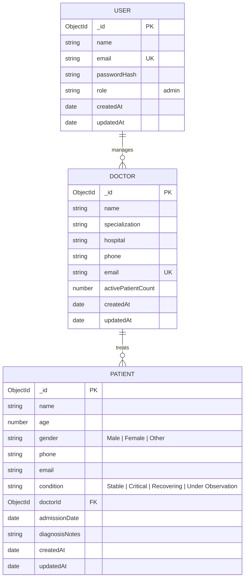
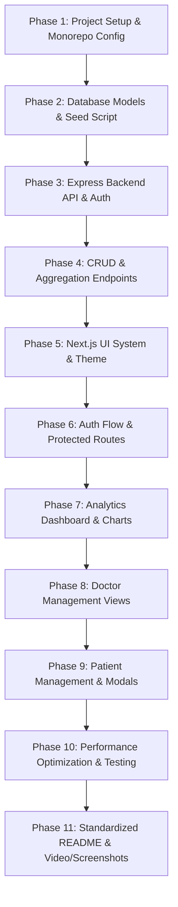

# Doctor Tracker — Project Implementation Plan & Technical Specification

> **System Overview:** Doctor Tracker is an enterprise-grade administrative web application engineered for authenticated medical administrators to monitor, manage, and analyze doctors and their assigned patient cohorts. Built with a performance-first mindset, the platform pairs an Express.js REST API and MongoDB aggregation engine with a Next.js administrative frontend.

---

## Table of Contents
1. [Architecture & System Design](#1-architecture--system-design)
   - [1.1 High-Level Architecture](#11-high-level-architecture)
   - [1.2 Repository Structure](#12-repository-structure)
   - [1.3 Core Backend Utilities & Modular Patterns](#13-core-backend-utilities--modular-patterns)
2. [Database Schema & Indexing Strategy (MongoDB)](#2-database-schema--indexing-strategy-mongodb)
3. [REST API Design & Endpoint Specification](#3-rest-api-design--endpoint-specification)
4. [Frontend Architecture & UI/UX Design System](#4-frontend-architecture--uiux-design-system)
5. [Performance & Query Optimization Strategies](#5-performance--query-optimization-strategies)
6. [Security & Authentication Architecture](#6-security--authentication-architecture)
7. [Step-by-Step Implementation Roadmap](#7-step-by-step-implementation-roadmap)
8. [Documentation & README Blueprint](#8-documentation--readme-blueprint)

---

## 1. Architecture & System Design

### 1.1 High-Level Architecture

The system follows a clean **client-server decoupled monorepo architecture**:

```
┌─────────────────────────────────────────────────────────────┐
│                    Doctor Tracker System                    │
└─────────────────────────────────────────────────────────────┘
                               │
            ┌──────────────────┴──────────────────┐
            ▼                                     ▼
┌─────────────────────────┐           ┌─────────────────────────┐
│     Client (Next.js)    │           │   Backend (Express.js)  │
│  - App Router (v14/v15) │  HTTP/    │  - Node.js + Express    │
│  - TypeScript + Tailwind│  REST     │  - TypeScript           │
│  - TanStack Query       │ ◄───────► │  - Zod Validation       │
│  - Recharts Dashboard   │           │  - JWT Authentication   │
│  - Lucide Icons         │           │  - Central Error Handler│
└─────────────────────────┘           └───────────┬─────────────┘
                                                  │ Mongoose ODM
                                                  ▼
                                      ┌─────────────────────────┐
                                      │    Database (MongoDB)   │
                                      │  - Indexed Collections  │
                                      │  - Aggregation Pipeline │
                                      │  - Fast Lookup & Facets │
                                      └─────────────────────────┘
```

### 1.2 Repository Structure

```
doctor-tracker/
├── PROJECT_IMPLEMENTATION.md        # Technical execution roadmap
├── README.md                        # Submission documentation with architecture & technical decisions
├── package.json                     # Monorepo root scripts (concurrent dev run)
├── client/                          # Next.js Application
│   ├── src/
│   │   ├── app/
│   │   │   ├── (auth)/
│   │   │   │   └── login/
│   │   │   │       └── page.tsx
│   │   │   ├── (dashboard)/
│   │   │   │   ├── layout.tsx       # Sidebar, Topbar, Auth Guard
│   │   │   │   ├── dashboard/
│   │   │   │   │   └── page.tsx     # Analytics KPIs & Visual Charts
│   │   │   │   ├── doctors/
│   │   │   │   │   ├── page.tsx     # Doctor Directory (Search, Filter, Pagination)
│   │   │   │   │   └── [id]/
│   │   │   │   │       └── page.tsx # Doctor Profile + Assigned Patients
│   │   │   │   └── patients/
│   │   │   │       └── page.tsx     # Global Patients Table & CRUD Operations
│   │   │   ├── globals.css          # Design tokens, medical theme, animations
│   │   │   └── layout.tsx           # Providers (QueryClient, Auth, Toast)
│   │   ├── components/
│   │   │   ├── common/              # Button, Input, Modal, Badge, Dropdown, Table, Pagination
│   │   │   ├── layout/              # Sidebar, Header, MobileNav
│   │   │   ├── dashboard/           # MetricCard, PatientTrendChart, ConditionPieChart, TopDoctorsChart
│   │   │   ├── doctors/             # DoctorCard, DoctorTable, DoctorFilterModal, CreateDoctorModal
│   │   │   └── patients/            # PatientTable, CreatePatientModal, EditPatientModal, DeleteDialog
│   │   ├── lib/
│   │   │   ├── api.ts               # Axios / Fetch client with auth interceptors
│   │   │   ├── query-client.ts      # TanStack Query configuration
│   │   │   └── utils.ts             # Date formatting, debounce, CN utility
│   │   ├── services/                # Frontend API Service layer (Typed HTTP calls for React Query)
│   │   │   ├── auth.service.ts      # Login, session verification, token handling
│   │   │   ├── doctor.service.ts    # Fetch doctors, search, filter, assign/delete patients
│   │   │   ├── patient.service.ts   # Fetch patients, CRUD actions, multi-filter queries
│   │   │   └── analytics.service.ts # Fetch dashboard metrics, chart time-series data
│   │   ├── types/                   # Shared TypeScript interfaces
│   │   ├── middleware.ts            # Route protection & JWT redirect logic
│   │   └── .env.example             # Frontend environment variables
├── server/                          # Express.js REST API Server (Modular Architecture)
│   ├── src/
│   │   ├── app.ts                   # Express app initialization, cors, cookie-parser, routes, error handlers
│   │   ├── server.ts                # Mongoose connection bootstrap & HTTP port listener
│   │   ├── app/
│   │   │   ├── builders/
│   │   │   │   └── QueryBuilder.ts  # Generic Mongoose QueryBuilder (search, filter, sort, paginate, fields, countTotal)
│   │   │   ├── config/
│   │   │   │   └── index.ts         # Environment variables (port, database_url, jwt secrets, salt)
│   │   │   ├── errors/
│   │   │   │   ├── AppError.ts      # Custom operational error class
│   │   │   │   ├── handleValidationError.ts # Mongoose validation error extractor
│   │   │   │   ├── handleDuplicateError.ts  # MongoDB 11000 duplicate key error handler
│   │   │   │   └── handleCastError.ts       # Mongoose Invalid ObjectId cast error handler
│   │   │   ├── helpers/
│   │   │   │   ├── catchAsync.ts    # Async request handler wrapper (replaces try-catch)
│   │   │   │   ├── sendResponse.ts  # Standardized API response format ({ success, statusCode, message, meta, data })
│   │   │   │   └── jwtHelper.ts     # JWT token generation & verification helpers
│   │   │   ├── interface/
│   │   │   │   ├── error.ts         # TErrorSources, TGenericErrorResponse
│   │   │   │   └── index.d.ts       # Express Request interface extension (req.user)
│   │   │   ├── middlewares/
│   │   │   │   ├── auth.ts          # Role-based access control & token verification middleware
│   │   │   │   ├── globalErrorHandler.ts # Centralized error handler handling AppError, Zod, Mongoose errors
│   │   │   │   ├── validateRequest.ts   # Zod request validation (validateRequest, validateBody, validateQuery, validateParams)
│   │   │   │   └── notFound.ts      # Standard 404 route handler
│   │   │   ├── modules/
│   │   │   │   ├── User/
│   │   │   │   │   ├── user.interface.ts
│   │   │   │   │   ├── user.constant.ts
│   │   │   │   │   ├── user.model.ts
│   │   │   │   │   ├── user.validation.ts
│   │   │   │   │   ├── user.service.ts
│   │   │   │   │   ├── user.controller.ts
│   │   │   │   │   └── user.route.ts
│   │   │   │   ├── Doctor/
│   │   │   │   │   ├── doctor.interface.ts
│   │   │   │   │   ├── doctor.constant.ts  # doctorSearchableFields, doctorFilterableFields
│   │   │   │   │   ├── doctor.model.ts
│   │   │   │   │   ├── doctor.validation.ts
│   │   │   │   │   ├── doctor.service.ts   # QueryBuilder integration (search, filter, sort, paginate)
│   │   │   │   │   ├── doctor.controller.ts
│   │   │   │   │   └── doctor.route.ts
│   │   │   │   ├── Patient/
│   │   │   │   │   ├── patient.interface.ts
│   │   │   │   │   ├── patient.constant.ts # patientSearchableFields, condition/date filters
│   │   │   │   │   ├── patient.model.ts
│   │   │   │   │   ├── patient.validation.ts
│   │   │   │   │   ├── patient.service.ts  # QueryBuilder integration + doctor population
│   │   │   │   │   ├── patient.controller.ts
│   │   │   │   │   └── patient.route.ts
│   │   │   │   └── Analytics/
│   │   │   │       ├── analytics.service.ts # High performance MongoDB $facet aggregation pipeline
│   │   │   │       ├── analytics.controller.ts
│   │   │   │       └── analytics.route.ts
│   │   │   ├── routes/
│   │   │   │   └── index.ts         # App router aggregator (/auth, /doctors, /patients, /analytics)
│   │   │   └── seeds/
│   │   │       └── seed.ts          # Seed script for Admin, Doctors, and Patients
│   ├── .env.example
│   └── tsconfig.json
```

### 1.3 Core Backend Utilities & Modular Patterns

The backend strictly implements the following production-grade architectural patterns and utilities:

#### 1. `QueryBuilder<T>` Pattern (`server/src/app/builders/QueryBuilder.ts`)
Encapsulates all searching, filtering, sorting, pagination, and projection logic into a fluent, chainable builder:
- **`search(searchableFields)`**: Performs case-insensitive regex searches on target fields.
- **`filter()`**: Strips pagination/sorting keys and applies remaining filters directly to Mongoose queries.
- **`sort()`**: Maps named sort keys (`newest`, `mostVoted`, `endingSoon`) with fallback to `-createdAt`.
- **`paginate()`**: Computes skip/limit dynamically from `page` and `limit` query parameters.
- **`fields()`**: Dynamic field projection (`select`) excluding internal fields (`-__v`).
- **`countTotal()`**: Calculates total matched documents and returns pagination metadata (`page`, `limit`, `total`, `totalPage`).

```typescript
// Usage in doctor.service.ts & patient.service.ts
const getAllDoctorsFromDB = async (query: Record<string, unknown>) => {
  const doctorQuery = new QueryBuilder(Doctor.find(), query)
    .search(doctorSearchableFields)
    .filter()
    .sort()
    .paginate()
    .fields();

  const result = await doctorQuery.modelQuery;
  const meta = await doctorQuery.countTotal();

  return { meta, result };
};
```

#### 2. Standardized Error Handling Architecture
- **`AppError` (`server/src/app/errors/AppError.ts`)**: Custom operational error class maintaining `statusCode`, `status` (`fail`/`error`), `isOperational`, and field-specific `errors`.
- **Mongoose Error Handlers**:
  - `handleValidationError`: Extracts validation failure paths and messages.
  - `handleDuplicateError`: Detects MongoDB error code 11000 duplicate keys and formats friendly messages.
  - `handleCastError`: Catches invalid MongoDB ObjectIds and returns structured 400 Bad Request responses.
- **`globalErrorHandler` (`server/src/app/middlewares/globalErrorHandler.ts`)**: Catches all errors across the application, normalizes them into a consistent structure, strips stack traces in production, and dispatches uniform JSON.
- **`notFound` (`server/src/app/middlewares/notFound.ts`)**: Catches unmatched routes and yields clean 404 responses.

#### 3. Flow Helpers: `catchAsync` & `sendResponse`
- **`catchAsync` (`server/src/app/helpers/catchAsync.ts`)**: Higher-order async handler eliminating boilerplate `try-catch` blocks in controllers.
- **`sendResponse<T>` (`server/src/app/helpers/sendResponse.ts`)**: Uniform response dispatcher formatting all successful API responses with `statusCode`, `success`, `message`, optional `meta`, and `data`.

#### 4. Request Validation (`validateRequest.ts`)
- Leverages Zod schemas with sub-utilities (`validateRequest`, `validateBody`, `validateQuery`, `validateParams`) to guarantee request validity prior to controller execution.

#### 5. Role-Based Access Control (`auth.ts`)
- **`auth(...requiredRoles: TUserRole[])`**:
  - Extracts JWT from `Authorization` header (`Bearer token`) or httpOnly cookie.
  - Verifies token signature & expiration.
  - Verifies user existence and blocks if `user.isBlocked` or `user.isDeleted`.
  - Enforces role permission hierarchy (`admin`, `staff`).
  - Attaches `req.user = verifiedUser` for downstream handlers.

---

## 2. Database Schema & Indexing Strategy (MongoDB)

### 2.1 Entity Relationship Diagram (ERD)



### 2.2 Schema Definitions & Optimized Indexes

#### **1. User (Admin) Collection**
- **Fields**:
  - `name`: String (Required, trimmed)
  - `email`: String (Required, lowercase, unique, trimmed)
  - `password`: String (Bcrypt salted hash, minimum 6 characters)
  - `role`: String (Enum: `['admin', 'staff']`, default: `'admin'`)
  - `timestamps`: `createdAt`, `updatedAt`
- **Indexes**:
  - `{ email: 1 }` (Unique index for instantaneous login lookup)

#### **2. Doctor Collection**
- **Fields**:
  - `name`: String (Required, trimmed)
  - `specialization`: String (Required, e.g., "Cardiology", "Neurology", "Pediatrics", "Oncology", "Orthopedics")
  - `hospital`: String (Required, e.g., "Apollo Hospital", "Square Hospital", "Metropolitan Clinic")
  - `phone`: String (Required)
  - `email`: String (Required, unique, lowercase)
  - `activePatientCount`: Number (Default: 0, maintained via triggers/middleware for O(1) count retrieval)
  - `timestamps`: `createdAt`, `updatedAt`
- **Indexes**:
  - **Text Index**: `{ name: "text", specialization: "text", hospital: "text" }` for full-text search capability.
  - **Compound Filter Index**: `{ specialization: 1, hospital: 1, createdAt: -1 }` for high-throughput multi-faceted filtering.
  - **Sort & Pagination Index**: `{ createdAt: -1 }` for default reverse-chronological feeds.
  - **Unique Index**: `{ email: 1 }`.

#### **3. Patient Collection**
- **Fields**:
  - `name`: String (Required, trimmed)
  - `age`: Number (Required, min 0, max 130)
  - `gender`: String (Enum: `['Male', 'Female', 'Other']`)
  - `phone`: String (Required)
  - `email`: String (Optional)
  - `condition`: String (Enum: `['Stable', 'Critical', 'Recovering', 'Under Observation']`)
  - `doctorId`: ObjectId (Ref: `Doctor`, Required)
  - `admissionDate`: Date (Default: `Date.now`)
  - `diagnosisNotes`: String (Optional)
  - `timestamps`: `createdAt`, `updatedAt`
- **Indexes**:
  - **Doctor-specific Lookup**: `{ doctorId: 1, createdAt: -1 }` for querying patients under a doctor with instant pagination.
  - **Condition & Date Compound**: `{ condition: 1, admissionDate: -1 }` for condition-specific analytics and filters.
  - **Patient Search Index**: `{ name: 1, phone: 1 }` or full text index `{ name: "text", email: "text" }`.
  - **Date-wise Filter Index**: `{ admissionDate: -1 }`.

---

## 3. REST API Design & Endpoint Specification

All responses adhere to a consistent standardized response envelope formatted by `sendResponse<T>`:
```json
{
  "success": true,
  "statusCode": 200,
  "message": "Doctors retrieved successfully",
  "meta": {
    "page": 1,
    "limit": 10,
    "total": 120,
    "totalPage": 12
  },
  "data": [ ... ]
}
```

### 3.1 Authentication Endpoints (`/api/v1/auth`)
| Method | Endpoint | Description | Auth Required |
|---|---|---|---|
| `POST` | `/login` | Authenticates admin credentials, issues JWT token | No |
| `GET` | `/me` | Returns current authenticated user profile | Yes (Bearer Token) |
| `POST` | `/logout` | Invalidates session (clears token cookie) | Yes |

### 3.2 Doctor Management Endpoints (`/api/v1/doctors`)
| Method | Endpoint | Query / Body Params | Description |
|---|---|---|---|
| `GET` | `/` | `?page=1&limit=10&search=Cardio&specialization=Cardiology&hospital=Apollo&startDate=2026-01-01&endDate=2026-10-01` | Paginated, filtered, and searchable list of doctors |
| `POST` | `/` | Body: `{ name, specialization, hospital, phone, email }` | Creates a new doctor profile |
| `GET` | `/:id` | Path: `id` | Retrieves single doctor profile with summary metrics |
| `PUT` | `/:id` | Body: Partial doctor fields | Updates doctor details |
| `DELETE`| `/:id` | Path: `id` | Deletes a doctor (cascading or disassociating patients) |
| `GET` | `/:id/patients` | `?page=1&limit=10&search=John` | Retrieves paginated patients specifically under this doctor |
| `POST` | `/:id/patients` | Body: `{ name, age, gender, phone, email, condition, admissionDate, diagnosisNotes }` | Adds a new patient directly assigned to this doctor |
| `DELETE`| `/:id/patients/:patientId` | Path: `id`, `patientId` | Removes patient from this doctor's roster |

### 3.3 Patient Management Endpoints (`/api/v1/patients`)
| Method | Endpoint | Query / Body Params | Description |
|---|---|---|---|
| `GET` | `/` | `?page=1&limit=10&search=Rahman&condition=Critical&doctorId=xyz&startDate=...&endDate=...` | Global paginated patient registry with multi-parameter filtering |
| `POST` | `/` | Body: Patient object (including `doctorId`) | Enrolls a new patient |
| `GET` | `/:id` | Path: `id` | Single patient details with populated doctor details |
| `PUT` | `/:id` | Body: Updated patient fields | Edits patient record |
| `DELETE`| `/:id` | Path: `id` | Permanently deletes patient record |

### 3.4 Dashboard & Analytics Endpoints (`/api/v1/analytics`)
| Method | Endpoint | Description |
|---|---|---|
| `GET` | `/overview` | Aggregated metrics: Total Doctors, Total Patients, Critical Cases, Avg Patients per Doctor |
| `GET` | `/patients-per-doctor` | Top 10 doctors ranked by patient count (for Bar Chart) |
| `GET` | `/patient-condition-distribution` | Count of patients grouped by `condition` (for Pie/Doughnut Chart) |
| `GET` | `/admissions-timeline` | Monthly or 30-day time-series admissions count (for Area Chart) |
| `GET` | `/hospital-distribution` | Doctor and patient distribution by hospital facility |

---

## 4. Frontend Architecture & UI/UX Design System

### 4.1 Aesthetic Concept: *Clinical Obsidian / Modern Vitality*
- **Palette**: Deep slate/charcoal background (`#0b0f19` in dark mode or crisp clean medical white/slate in light mode), accented with medical emerald (`#10b981`), sapphire blue (`#3b82f6`), and alert ruby (`#f43f5e`).
- **Typography**: `Inter` / `Outfit` via `next/font` for high legibility in dense data tables.
- **Glassmorphism**: Subtle backdrop-blur panels (`backdrop-blur-md bg-white/70 dark:bg-slate-900/80 border border-slate-200/60 dark:border-slate-800`).
- **Micro-interactions**: Framer-motion / CSS transitions on card hover, skeleton loading during query fetch, animated badges, and smooth tab transitions.

### 4.2 Key Pages & User Flows

#### 1. Authentication View (`/login`)
- Split-screen layout: High-impact medical illustration/graphics on left, sleek login card on right.
- Client-side validation with real-time error hints.
- Demo Credentials Quick-Fill button for rapid reviewer evaluation.

#### 2. Analytics Dashboard (`/dashboard`)
- **Metric Cards Grid**:
  - Total Registered Doctors (with weekly % trend).
  - Total Active Patients (with critical indicator alert).
  - Average Patients per Doctor.
  - New Admissions This Month.
- **Interactive Visualizations (Recharts)**:
  - **Admissions Trend (Area Chart)**: Dynamic 30-day or 12-month patient admission velocity.
  - **Patient Condition Ratio (Doughnut Chart)**: Visualizing Critical, Stable, Recovering proportions.
  - **Patient Load Per Doctor (Horizontal Bar Chart)**: Clear insight into doctor workloads.
  - **Hospital Distribution (Bar/Column Chart)**: Breakdown by hospital network.

#### 3. Doctors Management (`/doctors` & `/doctors/[id]`)
- **Header Action Bar**: Search input with 300ms debounce, Specialization dropdown, Hospital filter, Date range picker, and "+ Add Doctor" primary CTA.
- **Doctor Table & Card Toggle**: Switch between tabular data density view and rich card layout.
- **Doctor Detail View (`/doctors/[id]`)**:
  - Doctor profile header (Specialization, Hospital, Contact, Patient count badge).
  - Embedded Tabular Roster: All patients currently assigned to this doctor.
  - Quick "+ Assign Patient" modal directly tied to this doctor.
  - "Remove from Doctor" action per patient row.

#### 4. Dedicated Patient Management (`/patients`)
- **Global Patient Registry**: High-density table displaying Name, Age, Gender, Contact, Condition Badge, Assigned Doctor (clickable chip linking to doctor profile), Admission Date, and Action Menu.
- **Multi-Filter Bar**:
  - Live search (Name, Phone, Email).
  - Condition pill selector (`All`, `Stable`, `Critical`, `Recovering`, `Under Observation`).
  - Date-picker filter (Admission date range).
  - Doctor filter dropdown.
- **CRUD Operations**:
  - "Add Patient" modal with doctor selection dropdown.
  - "Edit Patient" sliding drawer or modal.
  - "Delete Patient" alert dialog with safety confirmation.

---

## 5. Performance & Query Optimization Strategies

### 5.1 MongoDB Query Optimizations
1. **Single-Pass Aggregation (`$facet`) for Analytics**:
   Instead of firing 5 distinct database queries for the dashboard, execute a single `$facet` aggregation pipeline that returns counts, condition groupings, and time-series trends in one network trip.
2. **Lean Queries**:
   Use `.lean()` on read-heavy routes (`find()`, `findOne()`) to bypass Mongoose document hydration overhead, resulting in 3x faster response times.
3. **Selective Projection**:
   Always specify projected fields (e.g., `.select('name specialization hospital email activePatientCount')`) to minimize memory allocation and network payload.
4. **Indexed Pagination**:
   Avoid large `skip` penalties by indexing the sort key (`createdAt: -1`). For extreme scalability, cursor-based pagination can be leveraged.

### 5.2 Next.js & Frontend Optimizations
1. **Debounced Search**:
   300ms debounce on all text search queries to prevent spamming the backend.
2. **TanStack Query (React Query) Caching**:
   - `staleTime: 60 * 1000` (1 minute) for dashboard analytics.
   - `keepPreviousData: true` during pagination to eliminate UI layout shifts and flashes.
   - Optimistic cache updates on patient additions and deletions.
3. **Code Splitting & Lazy Loading**:
   Heavy chart components (`recharts`) loaded via dynamic imports (`next/dynamic`) to achieve sub-second initial LCP (Largest Contentful Paint).

---

## 6. Security & Authentication Architecture

1. **Authentication Token Flow**:
   - Admin submits credentials to `/api/v1/auth/login`.
   - Backend validates with `bcrypt.compare` against hashed password.
   - Signs a secure JWT (containing `{ userId, role }`) with 24-hour expiration.
   - Token is stored securely in an `httpOnly, secure, sameSite: 'strict'` cookie or Bearer token header.
2. **Route Guards**:
   - **Backend**: Express `verifyAuth` middleware decodes token, attaches `req.user`, and rejects unauthorized requests with 401/403.
   - **Frontend**: Next.js `middleware.ts` intercepts requests to `/dashboard/*`, `/doctors/*`, and `/patients/*`. If no valid token cookie is present, redirects to `/login`.
3. **Data Validation**:
   - Strict Zod schemas validating incoming request bodies and query parameters on both frontend and backend to mitigate injection and malformed payloads.
4. **Security Headers & Rate Limiting**:
   - `helmet` for secure HTTP headers.
   - `express-rate-limit` to prevent brute-force attacks on the `/auth/login` endpoint.

---

## 7. Step-by-Step Implementation Roadmap



### Detailed Phase Breakdown

- **Phase 1: Project Setup & Monorepo Config**
  - Initialize root `package.json` with scripts for `npm run dev` (running client and server concurrently).
  - Setup `server/` with TypeScript, Express, Mongoose, Zod, Dotenv, Cors, Helmet, Morgan.
  - Setup `client/` with Next.js App Router, TypeScript, Tailwind CSS, Lucide React, Recharts, TanStack Query, Axios.
  - Configure `.env.example` for both services.

- **Phase 2: Database Models, Indexes & Seeding**
  - Implement Mongoose models (`User`, `Doctor`, `Patient`) with strict typing.
  - Apply compound indexes and text indexes as specified in Section 2.
  - Create a realistic database seeding script (`npm run seed`) creating:
    - 1 Default Admin (`admin@doctortracker.com` / `admin123`).
    - 15+ Doctors across diverse specializations and hospitals.
    - 60+ Patients with varied conditions and admission dates.

- **Phase 3: Core Architecture, Builders, Middlewares & Authentication**
  - Implement **`QueryBuilder<T>`** (`server/src/app/builders/QueryBuilder.ts`):
    - Methods: `.search()`, `.filter()`, `.sort()`, `.paginate()`, `.fields()`, `.countTotal()`.
  - Implement **Error Handling System**:
    - `AppError`: Custom operational error class.
    - Mongoose handlers: `handleValidationError`, `handleDuplicateError` (code 11000), `handleCastError` (invalid ObjectId).
    - `globalErrorHandler`: Centralized middleware handling Zod, Mongoose, and AppError exceptions.
    - `notFound`: 404 middleware.
  - Implement **Flow Helpers**:
    - `catchAsync`: Eliminates try-catch repetition in controllers.
    - `sendResponse<T>`: Standardized API response format (`{ success, statusCode, message, meta, data }`).
    - `jwtHelper`: Token generation & verification.
  - Implement **Request Validation & Security Middlewares**:
    - `validateRequest`, `validateBody`, `validateQuery`, `validateParams` with Zod.
    - `auth(...requiredRoles)`: Role-based JWT verification, checks for token expiration, `isBlocked`, and `isDeleted`.
  - Implement **User Module**: `user.interface.ts`, `user.model.ts`, `user.service.ts`, `user.controller.ts`, `user.route.ts`.

- **Phase 4: Doctor, Patient & Analytics Modular Implementations**
  - Implement **Doctor Module** (`app/modules/Doctor/`):
    - `doctor.interface.ts`, `doctor.constant.ts` (`doctorSearchableFields = ['name', 'specialization', 'hospital', 'phone', 'email']`).
    - `doctor.model.ts` (with compound & text indexes).
    - `doctor.service.ts`: Integrates `QueryBuilder` for search, filter, sort, paginate + handles doctor-patient roster operations (`getDoctorPatients`, `addPatientToDoctor`, `removePatientFromDoctor`).
    - `doctor.controller.ts`: Wrapped with `catchAsync` and returning via `sendResponse`.
    - `doctor.route.ts`: Protected with `auth('admin')` and validated with `validateRequest`.
  - Implement **Patient Module** (`app/modules/Patient/`):
    - `patient.interface.ts`, `patient.constant.ts` (`patientSearchableFields = ['name', 'phone', 'email']`).
    - `patient.model.ts` (with doctor reference and condition/date indexes).
    - `patient.service.ts`: Integrates `QueryBuilder` with `.populate('doctorId')`, date-range and condition filters.
    - `patient.controller.ts`: Wrapped with `catchAsync` and returning via `sendResponse`.
    - `patient.route.ts`: CRUD endpoints guarded with `auth('admin')`.
  - Implement **Analytics Module** (`app/modules/Analytics/`):
    - `analytics.service.ts`: MongoDB `$facet` aggregation pipeline executing overview KPIs, condition distribution, top doctors by patient load, and 30-day admission trends in a single database round-trip.
    - `analytics.controller.ts`: Wrapped with `catchAsync`.
    - `analytics.route.ts`: Aggregated under `/api/v1/analytics`.

- **Phase 5: Next.js Frontend Foundation & UI System**
  - Configure Tailwind with clinical color tokens, card borders, and glass effects.
  - Build reusable UI primitives: `Button`, `Input`, `Select`, `Badge`, `Modal`, `Table`, `Pagination`, `EmptyState`, `Skeleton`.
  - Build responsive administrative layout (`Sidebar`, `Header`, `Breadcrumbs`, `Mobile Drawer`).

- **Phase 6: Authentication & Route Protection**
  - Design premium login page with medical aesthetic and Quick Demo Login credentials button.
  - Setup Auth context / store and Next.js middleware protection.

- **Phase 7: Analytics Dashboard & Charts**
  - Build KPI metric summary cards with trend badges.
  - Implement Recharts components:
    - Area chart for monthly admission trends.
    - Doughnut chart for condition breakdown.
    - Bar chart for top doctors and patient loads.

- **Phase 8: Doctor Management Views**
  - Build `/doctors` directory page with live search bar, multi-select filters, and pagination.
  - Build "Add Doctor" modal with Zod form validation.
  - Build `/doctors/[id]` details view showing doctor profile and assigned patient roster with direct patient addition & removal.

- **Phase 9: Dedicated Patient Management View**
  - Build `/patients` registry page with real-time search, condition filter tabs, and date range filters.
  - Build "Add Patient" modal with doctor selection dropdown.
  - Build "Edit Patient" modal.
  - Build "Delete Patient" confirmation dialog with toast alerts.

- **Phase 10: Performance Optimization, Verification & Polish**
  - Validate MongoDB explain plans for query indexes.
  - Test responsive breakpoints (mobile, tablet, desktop).
  - Verify error states, 404s, and empty states.

- **Phase 11: Standardized README & Submission Documentation**
  - Draft production `README.md` following the required standardized template:
    1. **Description**: Elevator pitch for Doctor Tracker.
    2. **Setup Guide**: Step-by-step local installation with `.env.example`.
    3. **System Architecture**: High-level data flow and service interactions diagram.
    4. **Technical Decisions**: Deep dive into 2 specific engineering decisions (e.g., Decoupled Client-Server vs. Next.js Route Handlers; MongoDB Single-Pass `$facet` Aggregations vs. Multi-Query Lookups).
    5. **Visual Evidence**: Screenshots of desktop & mobile views.

---

## 8. Documentation & README Blueprint

The final `README.md` will strictly satisfy the specification template:

### Specification Compliance Matrix
| Required Section | Content Included |
|---|---|
| **Description** | Concise elevator pitch defining the purpose and value proposition of Doctor Tracker. |
| **Setup Guide** | Explicit prerequisite list, step-by-step commands for cloning, dependency installation, seeding, and local execution, along with complete `.env.example` documentation for both frontend and backend. |
| **System Architecture** | Mermaid sequence/data-flow diagrams showing client-server interaction, JWT verification, and database aggregation pipelines. |
| **Technical Decisions** | In-depth justification of 2 architectural decisions: <br>1. *Decoupled Express Backend vs. Next.js Monolithic API Routes* (Isolation of heavy aggregation compute, clean REST principles). <br>2. *MongoDB `$facet` Aggregation Pipeline for Single-Trip Analytics* (Zero N+1 queries, dramatic reduction in connection overhead). |
| **Visual Evidence** | High-resolution UI captures of the Dashboard, Doctor Management, Doctor Detail view with patient roster, and Global Patient Management in both Desktop and Mobile viewports. |
| **Credentials** | Pre-seeded default admin credentials (`admin@doctortracker.com` / `admin123`) clearly documented for immediate evaluation. |
